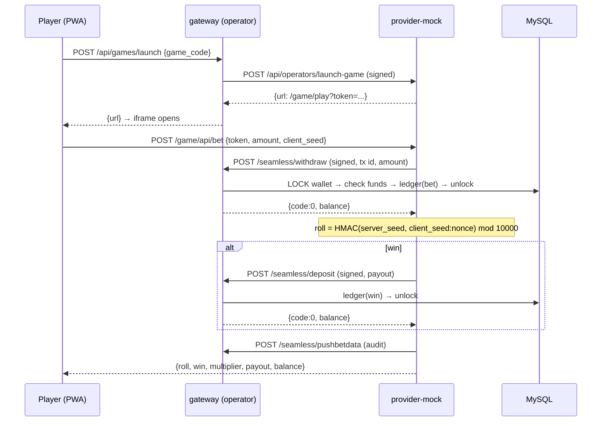

# Architecture & money flows

## Seamless wallet round (the iGaming core)



## Money integrity rules

1. **Every balance change is a ledger row.** `ledger_entries` is append-only;
   `balance_after` snapshots let you rebuild the wallet state at any point.
2. **Idempotency by (scope, tx_id).** Provider tx ids are unique keys; a
   replayed `withdraw`/`deposit` callback returns the current balance with
   `code: 0` instead of double-charging.
3. **Locked wallet mutation.** `SELECT ... FOR UPDATE` + version check;
   concurrent rounds from the same player serialize instead of racing.
4. **Signed callbacks with fresh timestamps.** Seamless uses `md5(operator_code +
   request_time + secret_key + method_word)`, ±5 min window kills replays;
   the payment webhook uses sha256 (client-verifiable via WebCrypto).
5. **Minor units everywhere.** int64 with scale 1e4 — no floats in storage.

## Deposit path (mock crypto processor)

```
player → POST /api/wallet/deposit {amount}
       ← {deposit_id, status: pending}
webhook → POST /api/wallet/webhook {deposit_id, status: confirmed, sign}
gateway: verify sign → MoveMoney(scope="payment", tx="deposit-N") → ledger
```

In production the webhook is the Bitcart/processor server callback; the
signature scheme is the same pattern.

## Provably fair

- session start: serverSeed generated, `sha256(server_seed)` published;
- every round: `roll = int(HMAC_SHA256(serverSeed, "clientSeed:nonce")[:8]) mod 10000`;
- `GET /game/api/fairness?token=` reveals the seed → anyone can recompute
  every roll and check the hash.
